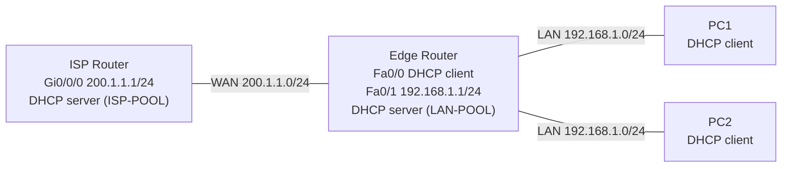

# 01 - Architecture and IP Plan

The lab uses two routers in Cisco Packet Tracer. The ISP Router hands an address to the Edge Router, and the Edge Router hands addresses to the PCs behind it.

## Contents

- Topology
- Devices and roles
- IP plan
- Design notes

## Topology

The full Packet Tracer workspace with the ISP Router, Edge Router and both PCs, device labels visible.

## Devices and roles

| Device | Role | Notes |
| --- | --- | --- |
| ISP Router | DHCP server for the WAN segment | Pool `ISP-POOL` |
| Edge Router | DHCP client on the WAN side, DHCP server for the LAN | Pool `LAN-POOL` |
| PC1, PC2 | DHCP clients | Set to obtain an address automatically |

## IP plan

| Segment | Network | Address assignment |
| --- | --- | --- |
| WAN (ISP side) | 200.1.1.0/24 | ISP Router `200.1.1.1` (static). Edge Router `Fa0/0` leases an address from `ISP-POOL` |
| LAN | 192.168.1.0/24 | Edge Router `Fa0/1` `192.168.1.1` (static). PCs lease from `LAN-POOL`. `.1` to `.10` excluded |

| Pool | Network | Default router | DNS |
| --- | --- | --- | --- |
| `ISP-POOL` | 200.1.1.0/24 | 200.1.1.1 | 8.8.8.8 |
| `LAN-POOL` | 192.168.1.0/24 | 192.168.1.1 | 8.8.8.8 |

## Design notes

- `192.168.1.0/24` is private address space (RFC 1918). `200.1.1.0/24` is an example ISP-side network used only inside the simulator. It is not an address allocation.
- The infographic in the source documentation mentions a LAN client range of `192.168.1.11 - 192.168.1.100`. The configuration itself offers the whole /24 minus the exclusions, so the pool is not limited to `.100`. See Troubleshooting and Known Issues.

Next: DHCP Concepts
