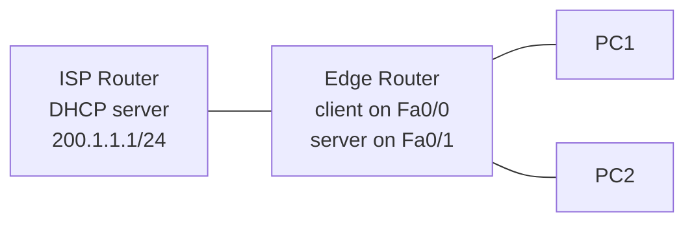

# Cisco DHCP Lab: ISP Router as DHCP Server, Edge Router as Client and LAN Server

A Cisco Packet Tracer lab where one router hands out addresses to another, and that router hands out addresses to the LAN behind it. It covers DHCP pools, excluded addresses, `ip address dhcp` on a WAN interface and layered troubleshooting.

> **Simulation only.** Everything here ran in Cisco Packet Tracer. No physical equipment was used.
> 

## Contents

- Overview
- Objectives
- Technologies
- Skills demonstrated
- Environment
- Architecture
- Scope
- Repository structure
- Setup
- Configuration
- Validation
- Troubleshooting
- Security considerations
- Lessons learned
- Future improvements
- Documentation index
- Author

## Overview

The ISP Router is a DHCP server on `200.1.1.0/24`. The Edge Router asks it for a WAN address with `ip address dhcp`, and serves `192.168.1.0/24` to its own clients. The result is a router that is a DHCP client and a DHCP server at the same time.

## Objectives

- Configure a router as a DHCP server with a pool, default gateway and DNS server
- Exclude infrastructure addresses from the pool
- Make a router interface obtain its address by DHCP
- Serve a LAN from the Edge Router
- Verify leases, pools and connectivity, and troubleshoot by layer

## Technologies

| Technology | Use |
| --- | --- |
| Cisco Packet Tracer | Simulation |
| Cisco IOS CLI | Router configuration |
| DHCP (DORA) | Address assignment |

## Skills demonstrated

| Area | Skill |
| --- | --- |
| DHCP | Pools, exclusions, gateway and DNS options, client role on an interface |
| Cisco IOS | Configuration modes, `no shutdown`, saving with `write memory` |
| Verification | `show ip dhcp pool`, `show ip dhcp binding`, `show ip interface brief`, `ping` |
| Troubleshooting | Layered approach, checking both ends, reading ARP behaviour |
| Documentation | Configs, IP plan, testing record, honest list of gaps |

## Environment

| Item | Detail |
| --- | --- |
| Simulator | Cisco Packet Tracer |
| Devices | ISP Router, Edge Router, two PCs |
| Addressing | WAN `200.1.1.0/24` (simulation-only example), LAN `192.168.1.0/24` |

## Architecture



Details: Architecture and IP Plan.

## Scope

In scope: DHCP server and client configuration on two routers, verification and basic troubleshooting.

Not in scope and not tested: lease renewal, DHCP relay, DHCP snooping, NAT, DNS resolution, a switch in the LAN and real hardware. See Testing and Validation.

## Repository structure

```
.
├── README.md
├── LICENSE
├── configs/
│   ├── README.md
│   ├── isp-router.txt
│   └── edge-router.txt
├── docs/
│   ├── 01-architecture-and-ip-plan.md
│   ├── 02-dhcp-concepts.md
│   ├── 03-isp-router-configuration.md
│   ├── 04-edge-router-configuration.md
│   ├── 05-testing-and-validation.md
│   ├── 06-troubleshooting-and-known-issues.md
│   ├── 07-security-considerations.md
│   ├── 08-lessons-learned.md
│   └── 09-command-reference.md
└── screenshots/
    └── README.md
```

## Setup

1. Open Cisco Packet Tracer and place two routers and two PCs.
2. Connect the ISP Router `Gi0/0/0` to the Edge Router `Fa0/0`, and the PCs to the Edge Router LAN side.
3. Paste `configs/isp-router.txt` into the ISP Router CLI first.
4. Paste `configs/edge-router.txt` into the Edge Router CLI.
5. Set both PCs to obtain an address automatically (DHCP).

Interface names follow the lab. Adjust them to match the ports you use.

## Configuration

| Device | Interface | Address | DHCP pool |
| --- | --- | --- | --- |
| ISP Router | `Gi0/0/0` | `200.1.1.1/24` | `ISP-POOL` (`200.1.1.0/24`, excluded `.1`) |
| Edge Router | `Fa0/0` | Leased from `ISP-POOL` | - |
| Edge Router | `Fa0/1` | `192.168.1.1/24` | `LAN-POOL` (`192.168.1.0/24`, excluded `.1` to `.10`) |

Walkthroughs: ISP Router, Edge Router.

## Validation

Interfaces up/up, leases visible in `show ip dhcp binding`, PCs holding addresses from `LAN-POOL`, and a ping from a PC to the ISP Router are the recorded checks. The first ping can time out while ARP resolves, which is expected. Full list in Testing and Validation.

## Troubleshooting

Work from cable to interface to address to DHCP service, and check both ends. Symptoms and the source documentation’s inconsistencies are in Troubleshooting and Known Issues.

## Security considerations

No DHCP security features were configured. Snooping, rate limiting and management hardening are listed in Security Considerations.

## Lessons learned

A router can be client and server at once. Exclude addresses before leasing. Interfaces start down. Save with `write memory`. See Lessons Learned.

## Future improvements

- Add a switch to the LAN and test more than two clients
- Test lease renewal and expiry
- Add DHCP relay with a separate server
- Configure DHCP snooping on a switch
- Add NAT and a return route so LAN clients reach beyond the ISP Router
- Add management hardening (passwords, SSH)

## Documentation index

| Document | Topic |
| --- | --- |
| 01 Architecture and IP Plan | Topology and addressing |
| 02 DHCP Concepts | DORA and IOS pieces |
| 03 ISP Router Configuration | DHCP server |
| 04 Edge Router Configuration | Client and LAN server |
| 05 Testing and Validation | Checks and untested items |
| 06 Troubleshooting and Known Issues | Symptoms and source gaps |
| 07 Security Considerations | Gaps and hardening |
| 08 Lessons Learned | Takeaways |
| 09 Command Reference | Commands used |
| Screenshots checklist | Evidence to add |
